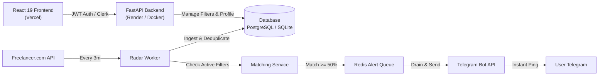

# 📡 FreelanceRadar

> **Real-time Freelancer.com project radar with instant Telegram notifications.**  
> Automatically monitors new freelance gigs, matches them against your custom skills and budget filters, and pings your Telegram the second a matching project is posted.

---

## ⚡ Overview

Winning freelance projects is all about **speed**. The first qualified bids received within the first few minutes have the highest chance of landing a client.

**FreelanceRadar** solves this by running an automated background engine that:
1. **Scrapes & Ingests**: Fetches active projects from Freelancer.com every 3 minutes.
2. **Filters & Matches**: Compares project skills, budget, and project type against your personal preferences.
3. **Instant Telegram Alerts**: Sends a rich Markdown notification directly to your Telegram with direct apply links.
4. **Self-Cleaning Storage**: Automatically purges jobs older than 24 hours to keep database storage lean and fast.

---

## 🚀 Key Features

* **Real-time Background Radar**: Ingests up to 50 active projects per cycle, deduplicating IDs in 1 query.
* **Instant Telegram Integration**: Deep-linked bot connection (`/start <user_id>`) for instant 1-click account linking.
* **Smart Matching Engine**: Weighted matching score ($\ge 50\%$) based on skills, project type (fixed / hourly), and min budgets.
* **Clerk Authentication**: Secure user management with Just-In-Time (JIT) auto-provisioning on first login.
* **Modern Dashboard**: Clean Deep Slate & Emerald UI built with React 19, Vite, and Tailwind CSS.
* **24-Hour Job Retention**: Automated background worker sweeps and purges expired jobs daily.
* **Production Hardened**:
  * **SlowAPI Rate Limiting**: 60 requests/minute per IP to guard against DoS and brute-force traffic.
  * **Hidden Documentation**: Swagger UI (`/docs`, `/redoc`, `/openapi.json`) automatically disabled in production.
  * **CORS Safe**: Seamlessly permits local development (`localhost:5173`) and Vercel domains (`*.vercel.app`).
  * **Docker Ready**: 12-line production container using `python:3.13-slim` and `uv`.

---

## 🛠️ Architecture & Tech Stack



| Component | Technology |
| :--- | :--- |
| **Backend** | Python 3.13, FastAPI, SQLAlchemy 2.0, Uvicorn, `uv` |
| **Database** | PostgreSQL (Production on Render) / SQLite (Local Dev) |
| **Cache & Queue** | Redis (with in-memory fallback for local dev) |
| **Rate Limiter** | SlowAPI (60 req/min default per client IP) |
| **Frontend** | React 19, TypeScript, Vite, Tailwind CSS v4, React Router v7 |
| **Authentication** | Clerk (JWT Session verification & Svix Webhook signatures) |
| **Notifications** | Telegram Bot API (`@Job_nofticationsbot`) |
| **Tests** | Pytest (124 unit & integration tests) |

---

## 📂 Project Structure

```text
FreelanceRadar/
├── backend/
│   ├── app/
│   │   ├── auth/          # Clerk JWT verification & JIT user provisioning
│   │   ├── core/          # Database, Redis, Logger, Limiter, Config
│   │   ├── job/           # Freelancer.com API client & schema normalizer
│   │   ├── model/         # SQLAlchemy 2.0 models (User, Filter, Job)
│   │   ├── router/        # API routers (user, filter, telegram, clerk)
│   │   ├── schema/        # Pydantic validation schemas
│   │   ├── service/       # Business logic (matching, alert queue, job/user service)
│   │   └── worker/        # Background radar worker (3m) & daily cleanup worker (24h)
│   ├── tests/             # 124 passing unit and integration tests
│   ├── Dockerfile         # Production container definition
│   ├── pyproject.toml     # Python dependencies managed with uv
│   └── main.py            # FastAPI application entrypoint & lifespan
│
└── Frontend/
    ├── src/
    │   ├── api/           # Native fetch API clients (filter, user)
    │   ├── Components/    # FilterForm, UI components
    │   ├── Pages/         # HomePage, DashboardPage, NotFoundPage
    │   └── main.tsx       # ClerkProvider & Router root
    ├── package.json       # Frontend dependencies
    └── vite.config.ts     # Vite configuration
```

---

## ⚙️ Environment Variables

### Backend (`backend/.env.local`)

| Variable | Description | Example |
| :--- | :--- | :--- |
| `MODE` | Application mode (`development` or `production`) | `production` |
| `DATABASE_URL` | PostgreSQL or SQLite connection string | `sqlite:///test.db` |
| `REDIS_URL` | Redis instance URL | `redis://localhost:6379/0` |
| `CLERK_SECRET_KEY` | Secret API key from Clerk Dashboard | `sk_test_...` |
| `JWKS_PUBLIC_KEY` | Clerk RSA Public Key for local JWT validation | `-----BEGIN PUBLIC KEY-----...` |
| `WEBHOOK_SECRET` | Svix secret key for Clerk Webhook events | `whsec_...` |
| `TELEGRAM_BOT_TOKEN` | Token generated by Telegram `@BotFather` | `123456789:ABC...` |
| `TELEGRAM_BOT_USERNAME` | Username of your Telegram bot | `Job_nofticationsbot` |
| `TELEGRAM_WEBHOOK_SECRET` | Secret token verified on webhook delivery | `random_secret_token` |
| `TELEGRAM_WEBHOOK_URL` | Public webhook URL for Telegram updates | `https://your-api.onrender.com/telegram/webhook` |
| `FRONTEND_URL` | Allowed frontend origin for CORS (no trailing slash) | `https://freelance-radar.vercel.app` |
| `ENABLE_DOCS` | *(Optional)* Explicitly toggle Swagger UI (`true`/`false`) | `false` |

### Frontend (`Frontend/.env.local`)

| Variable | Description | Example |
| :--- | :--- | :--- |
| `VITE_CLERK_PUBLISHABLE_KEY` | Clerk frontend publishable key | `pk_test_...` |
| `VITE_API_URL` | Backend API URL | `http://localhost:8000` |
| `VITE_TELEGRAM_BOT_USERNAME` | Username of your Telegram bot | `Job_nofticationsbot` |

---

## 🏁 Getting Started

### 1. Prerequisites
* **Python 3.13+** and [uv](https://docs.astral.sh/uv/) package manager
* **Node.js 18+** and **npm**
* *(Optional)* **Redis** running locally (or use memory fallback)

---

### 2. Backend Setup

```bash
# Navigate to backend directory
cd backend

# Install dependencies with uv
uv sync

# Configure your environment variables
cp .env.example .env.local
# (Edit .env.local with your credentials)

# Start the FastAPI server
uv run uvicorn main:app --reload --port 8000
```
Backend will start on `http://localhost:8000`. The radar worker and daily cleanup worker will initialize automatically.

---

### 3. Frontend Setup

```bash
# Navigate to frontend directory
cd Frontend

# Install packages
npm install

# Configure your environment variables
cp .env.example .env.local
# (Set VITE_CLERK_PUBLISHABLE_KEY and VITE_API_URL)

# Start development server
npm run dev
```
Frontend will be live at `http://localhost:5173`.

---

## 🤖 Connecting Your Telegram

1. Open your **FreelanceRadar Dashboard**.
2. Click **Connect Telegram Bot**.
3. Telegram will open with deep-link: `https://t.me/<bot_username>?start=<user_uuid>`.
4. Click **Start** in Telegram:
   * The bot immediately links your Telegram `chat_id` with your user account in the database.
   * You'll receive a confirmation message: *"✅ Telegram alerts connected successfully!"*
5. Return to the dashboard — the badge will instantly switch to **Telegram: Connected**.

---

## 📡 API Reference

| Method | Endpoint | Description | Auth Required |
| :--- | :--- | :--- | :--- |
| `GET` | `/` | Service health status | No |
| `GET` | `/user/me` | Current user profile & Telegram connection status | Yes (Bearer JWT) |
| `GET` | `/filter/` | Get active job filter preferences | Yes (Bearer JWT) |
| `POST` | `/filter/` | Create radar filter (1 filter per user) | Yes (Bearer JWT) |
| `PATCH` | `/filter/` | Update radar filter criteria | Yes (Bearer JWT) |
| `DELETE`| `/filter/` | Delete active radar filter | Yes (Bearer JWT) |
| `POST` | `/telegram/webhook` | Receives `/start` deep-links from Telegram Bot | Telegram Secret |
| `POST` | `/clerk/webhook` | Handles Clerk `user.created` / `user.deleted` events | Svix Signature |

---

## 🧪 Running Tests

The test suite covers models, services, background workers, and API routers.

```bash
# Run all backend tests
cd backend
uv run pytest -v

# Run frontend production build & TypeScript check
cd ../Frontend
npm run build
```

---

## 🐳 Docker Deployment

The backend includes a production-ready, minimal Dockerfile:

```bash
# Build Docker image
docker build -t freelanceradar-backend ./backend

# Run container
docker run -p 8000:8000 --env-file backend/.env.local freelanceradar-backend
```

---

## 📄 License

This project is licensed under the MIT License.
